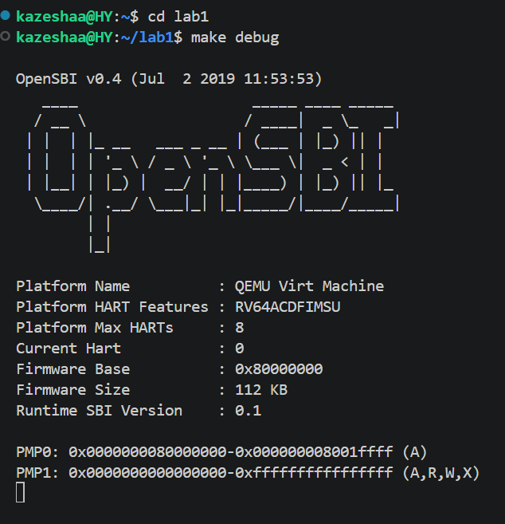
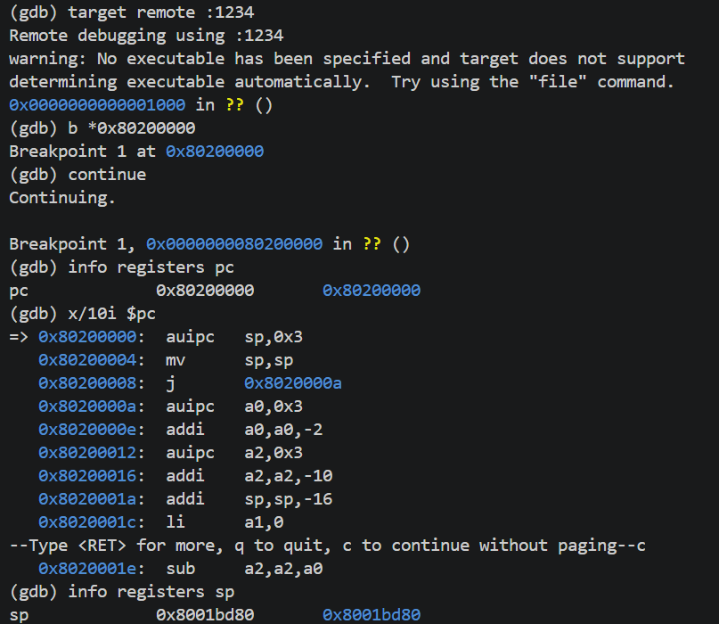

# 操作系统实验报告

## 实验基本信息

| 项目 | 内容 |
|------|------|
| **实验名称** | Lab 1: [最小可执行内核] |
| **小组成员** | 2412350-华洋 |
| **完成日期** | 2026-10-11 |

### 小组分工

练习如何分工？

| 成员 | 负责的练习/模块 |
|------|----------------|
| 2412350-华洋 | [练习一 练习二] |

实验报告如何分工？

全由我一人完成

## 一、实验目的

<!-- 说明本次实验的主要目标和预期成果 -->

本实验的主要目的是：

1. [目的1：理解 QEMU 模拟的 RISC-V 计算机的启动流程，掌握最小可执行内核如何正确对接到 QEMU 模拟器上。]
2. [目的2：学习程序内存布局与编译流程（特别是链接）相关知识，能够使用链接脚本描述内存布局，并进行交叉编译生成可执行文件与内核镜像。]
3. [目的3：掌握使用 OpenSBI 作为 bootloader 加载内核镜像，并借助 QEMU 进行模拟运行。]
4. [目的4：学会使用 OpenSBI 提供的服务，在屏幕上格式化打印字符串，用于后续调试。]

---

## 二、实验环境

你们使用的 AI 工具

| 成员 | AI 编程工具 | 底层模型 | 备注 |
|------|------------|---------|------|
| 学号1-姓名1 | [ Claude Code（终端 Agent）] | [DeepSeek-V4-Flash] | |

**说明：**
- **AI 编程工具**：指具体使用的终端工具、编辑器插件、桌面应用或浏览器界面
- **底层模型**：指该工具使用的大语言模型及版本

---

## 三、实验整体逻辑分析

### 2.1 本章节的逻辑主线

[请用自己的话描述本章实验的核心主线，例如：
- 本章围绕哪个核心主题展开？（例如：用户进程管理、虚拟内存、文件系统等）
核心主题：最小可执行内核的启动与运行。也就是让一个最简单的操作系统内核，能够被 QEMU 模拟的 RISC-V 计算机正确加载并跑起来。
- 整个实验解决什么问题？（例如：如何让用户程序运行在操作系统之上）]
解决什么问题：如何让内核从加电到执行第一条指令的完整链路走通。具体包括：硬件复位后 OpenSBI 如何初始化并加载内核、链接脚本如何决定内核的内存布局、交叉编译如何生成内核镜像、以及内核如何借助 OpenSBI 提供的接口实现最基础的格式化输出（为后续调试打基础）。

### 2.2 功能的逐步实现

[说明本章实验是按照什么顺序逐步实现各个功能的，以及为什么要按这个顺序，例如：

1. 首先用链接脚本描述内存布局 → 因为内核要被加载到 0x80200000，各段（.text、.data、.bss、栈）必须提前安排好位置，否则链接出来的镜像根本无法在预期地址运行。这是所有后续工作的物理基础。
2. 接着进行交叉编译，生成可执行文件和内核镜像 → 有了链接脚本确定布局后，才能用 riscv64 工具链把源码编译、链接成 ELF，再转成 QEMU 能加载的 bin 镜像。没有镜像，QEMU 就无物可跑。
3. 然后用 OpenSBI 作为 bootloader 加载内核镜像，并用 QEMU 模拟 → 内核镜像有了，但操作系统不能自己加载自己，必须由 OpenSBI 这个“先锋队”完成加载并跳转到 0x80200000。这一步才真正让内核跑起来。
4. 最后使用 OpenSBI 提供的服务，在屏幕上格式化打印字符串 → 内核跑起来后，内部是“无所有”的，连 printf 都没有。必须从 OpenSBI 的 ecall 接口开始，层层封装出 cprintf，才能输出调试信息。这是后续所有实验调试的基础，所以放在最后收尾。]

---

## 四、实验内容与实现

<!-- 
说明：本部分按照 exercises 文档中的练习顺序组织
每个功能模块或者练习中可能包含多项任务，请根据实际情况调整
-->

### 练习：[练习标题]

**负责人：** [2412350-华洋]

[练习一：
1. la sp, bootstacktop 完成了什么操作，目的是什么？
操作：la 是“load address”伪指令，把 bootstacktop 这个标签的地址加载到 sp 寄存器中。bootstacktop 在 .data 段，是 bootstack 这块内存的高地址端。
目的：为内核建立栈。RISC-V 的栈从高地址向低地址增长，所以 sp 要指向栈的高地址端（即 bootstacktop）。执行 C 函数（如 kern_init）时，需要栈来保存局部变量、函数返回地址等。如果不先设置 sp，后续任何函数调用都会出错。
2. tail kern_init 完成了什么操作，目的是什么？
操作：tail 是尾调用伪指令，本质上是 auipc + jalr 的组合，跳转到 kern_init 函数，但不压入返回地址（不保存 ra）。
目的：把控制权从汇编入口 kern_entry 移交给 C 语言编写的 kern_init，开始执行内核的主初始化逻辑。用 tail 而不是 call，是因为这是启动的最后一跳，不需要返回，可以节省栈空间和一次返回开销。

练习二：
1. RISC-V 硬件加电后最初执行的几条指令位于什么地址？
位于 0x1000。这是 QEMU 模拟的 RISC-V 复位地址，存放 MROM 固件代码。
2. 它们主要完成了哪些功能？
MROM 固件完成最基础的硬件初始化，然后跳转到 0x80000000，把控制权交给 OpenSBI。OpenSBI 初始化处理器环境后，把内核加载到 0x80200000，最后跳转到该地址，把控制权交给内核。
3. 调试过程：

target remote :1234

info registers pc → 0x1000

x/10i $pc → MROM 前几条指令（auipc、addi、csrr、jr）

b *0x80200000

continue → 断点命中，PC = 0x80200000

x/10i $pc → 内核入口指令

info registers sp → 0x8001bd80

观察结果：

加电后 PC = 0x1000

内核入口 PC = 0x80200000

sp 已指向 bootstacktop
]

---

## 五、测试与验证

<!-- 根据该实验的具体情况，提供完整的测试运行截图，应包含：
- 编译及运行成功的输出（make qemu），可能有多个
- 测试通过的结果（make grade），只有一个
-->

**测试截图：**

---

## 六、实验总结与收获

### 对操作系统的理解

1. 列出你们认为本实验中重要的知识点，以及与对应的 OS 原理中的知识点，并简要说明二者的含义、关系和差异
OpenSBI 加载内核到 0x80200000，对应 OS 原理中的操作系统引导。二者都是先于 OS 运行、负责加载 OS 的程序，区别在于本实验是 RISC-V 固件，真实 OS 常用 GRUB 等引导器。

entry.S 建立栈并跳转 kern_init，对应内核初始化。二者都是为内核运行做准备，区别在于本实验只建栈，真实 OS 还要初始化内存、中断、调度等。

链接脚本指定加载地址，对应内存布局与地址空间。二者都决定代码和数据的位置，区别在于本实验是简单物理地址，真实 OS 涉及虚拟内存和分页。

ecall 调用 SBI，对应系统调用与特权级切换。二者都通过特殊指令跨越特权级，区别在于本实验是 S→M，系统调用是 U→S。

GDB 远程调试 QEMU，对应内核调试。二者都是调试运行中的内核，区别在于本实验用模拟器，真实环境可能用 JTAG。
2. 列出你们认为 OS 原理中很重要、但在本实验中没有对应上的知识点
本实验只完成了最小内核启动，因此 OS 原理中的进程管理与调度、虚拟内存与分页、中断与异常处理、文件系统、设备驱动、并发与同步、用户态与系统调用接口都没有涉及，这些将在后续实验中展开。

### AI 协作开发的经验

[验证很重要，AI 给的命令和解释要在实际环境中跑一遍再写进报告。AI 还能把抽象概念和具体操作对应起来，降低理解门槛。例如 GDB 断点没命中时，AI 指出“断点要在程序运行到目标地址之前设好”，纠正了操作顺序，也让我理解了 watch 和 break 的区别。]

---

