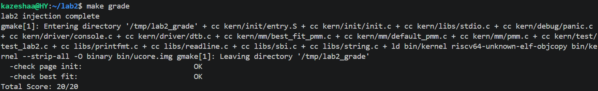
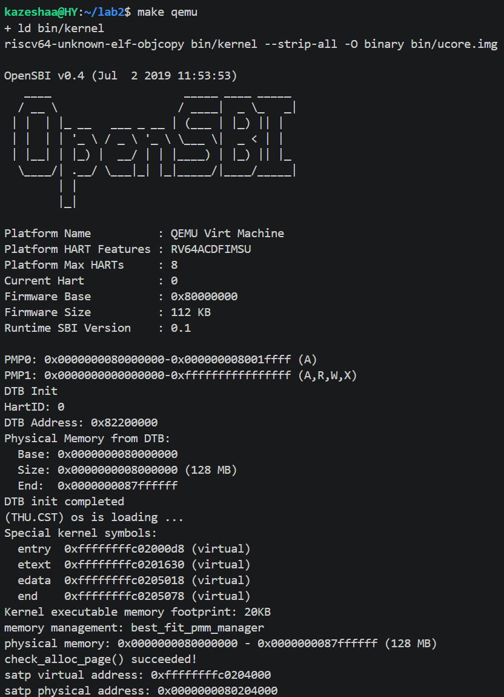
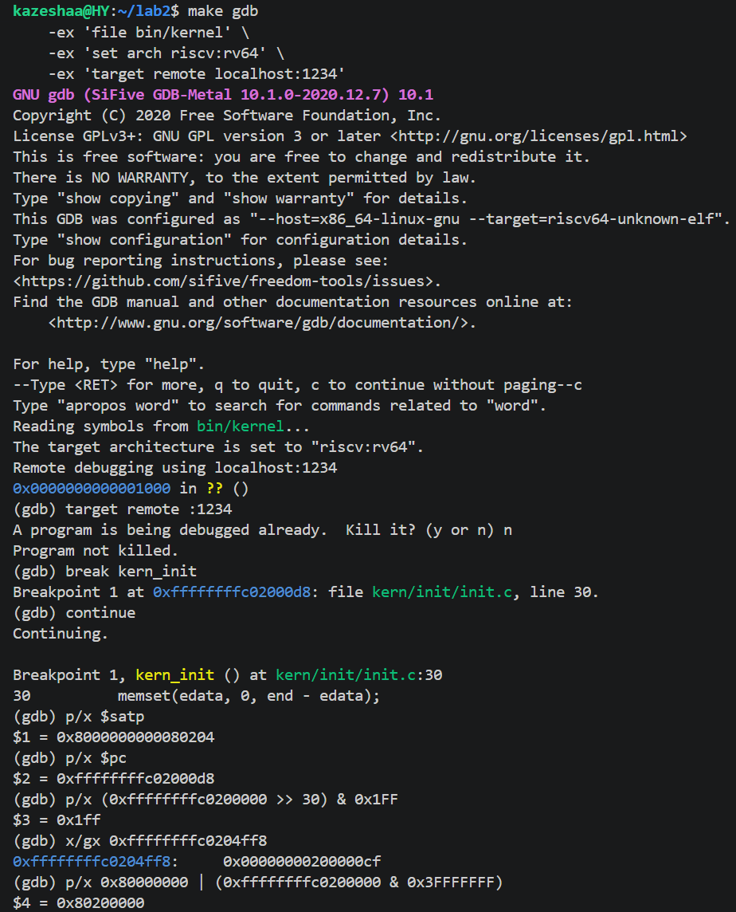

# 操作系统实验报告

## 实验基本信息

| 项目 | 内容 |
|------|------|
| **实验名称** | Lab 2: 物理内存和页表 |
| **小组成员** | [2412350]-[华洋] |
| **完成日期** | 2026-10-24 |

### 小组分工

| 成员 | 负责的练习/模块 |
|------|----------------|
| [2412350]-[华洋] | 物理内存初始化（`page_init`）、Best-Fit 分配器、Buddy System 分配器、gdb 页表查询分支任务 |

---

## 一、实验目的

1. 理解内核如何从「物理地址直接运行」切换到「虚拟地址空间运行」：通过构建 Sv39 页表并设置 `satp`，使内核以 `0xffffffffc0200000` 起始的高地址运行。
2. 掌握物理内存的发现、初始化与分配流程：从设备树（DTB）获取物理内存范围，建立物理页描述符（`struct Page`）数组，并把空闲页交给物理内存管理器。
3. 掌握连续内存分配算法：以 First-Fit 为参考，实现并接入 Best-Fit 分配器，并从零实现 Buddy System（伙伴系统），理解空闲块的合并与拆分。
4. 借助 gdb 观察一次 Sv39 地址翻译（页表查询）过程，理解硬件 MMU 的查表逻辑。
5. 学习使用 AI 辅助开发操作系统核心功能，并记录提示词设计、问题定位与迭代过程。

---

## 二、实验环境

| 成员 | AI 编程工具 | 底层模型 | 备注 |
|------|------------|---------|------|
| [学号1]-[姓名1] | Claude Code（终端 Agent） | [deepseek-v4-pro] | WSL Ubuntu + riscv64-unknown-elf-gcc 14.2.0 + QEMU 4.1.1 |

---

## 三、实验整体逻辑分析

### 3.1 本章节的逻辑主线

本章围绕「**物理内存的发现、组织与分配**」以及「**内核进入虚拟地址空间**」两个核心主题展开。在操作系统正式管理内存之前，必须先回答两个问题：**内存有多大、在哪里**（物理内存探测），以及**如何按页组织并分配它**（物理内存管理）。同时，为了让后续的虚拟内存管理成为可能，内核需要先把自身迁移到高地址虚拟空间运行（分页机制）。

整体实现链：

```
pmm_init() -> init_pmm_manager() -> page_init()
            -> init_memmap() -> alloc_pages() / free_pages()
```

### 3.2 功能的逐步实现顺序及原因

1. **首先实现分页机制**（`tools/kernel.ld` + `kern/init/entry.S`）。因为这是后续一切的基础——只有内核先进入虚拟地址空间、且虚拟地址与物理地址之间建立起确定映射，后面的 `page_init` 才能使用 `PADDR`/`KADDR` 等地址转换宏来操作内存。

2. **接着完成物理内存探测**（`kern/driver/dtb.c` + `page_init`）。有了分页和地址转换基础后，内核从 OpenSBI 传入的设备树中解析出物理内存范围，建立 `struct Page` 描述符数组，并正确区分「已占用」（OpenSBI、内核镜像、描述符数组）与「空闲」区域。

3. **然后建立物理内存管理框架并接入分配算法**（`pmm.c/pmm.h` + `default_pmm.c` + `best_fit_pmm.c` + `buddy_system_pmm.c`）。有了空闲页描述后，需要一个管理器来登记空闲块、响应 `alloc_pages`/`free_pages`。First-Fit 作为参考实现给出，Best-Fit 与 Buddy System 作为练习实现。

4. **最后用 gdb 验证页表查询过程**（分支任务）。在内存管理和分页都就绪后，从 `satp` 出发手动走一遍地址翻译，把「原理上的三级查表」落到具体寄存器、页表项上。

---

## 四、实验内容与实现

### 功能模块一：物理内存初始化

**负责人：** [2412350-华洋]

#### 模块功能描述

**需要实现/修改的函数：**

```c
static void page_init(void);   // kern/mm/pmm.c
```

**功能说明：**

`page_init()` 是物理内存管理的入口函数之一，由 `pmm_init()` 调用。它根据设备树提供的物理内存信息建立可管理物理页的描述符布局，把排除 OpenSBI、内核镜像和描述符数组占用空间后的完整空闲页交给当前 `pmm_manager`，为后续页面分配提供正确的初始状态。成功返回时应正确设置 `va_pa_offset`、`npage`、`pages`，输出探测到的物理内存范围，并完成初始空闲区的注册。

**核心实现逻辑（以注释说明）：**

```c
static void
page_init(void) {
    extern char end[];

    va_pa_offset = PHYSICAL_MEMORY_OFFSET;   // 内核虚实地址固定偏移 0xffffffff40000000

    uint64_t mem_base = get_memory_base();   // 来自 DTB，0x80000000
    uint64_t mem_size = get_memory_size();   // 128MB
    if (mem_base == 0 || mem_size == 0) {    // 设备树无效则终止
        panic("page_init: invalid physical memory info from DTB");
    }
    uintptr_t mem_end = mem_base + mem_size;
    cprintf("physical memory: 0x%016lx - 0x%016lx (%lu MB)\n",
            mem_base, mem_end - 1, mem_size / (1024 * 1024));

    npage = PPN(mem_end);                    // 物理页总数（含 DRAM 基址以下的"虚页"）
    pages = (struct Page *)ROUNDUP((void *)end, PGSIZE);  // 描述符数组放内核 bss 之后

    for (size_t i = 0; i < npage; i++) {     // 先全部标记 reserved
        SetPageReserved(pages + i);
    }

    uintptr_t freemem = PADDR((uintptr_t)pages + sizeof(struct Page) * npage);
    uintptr_t free_start = ROUNDUP(freemem, PGSIZE);   // 空闲内存从描述符数组之后开始
    if (free_start < mem_end) {              // 没有完整空闲页则不调用 init_memmap
        init_memmap(pa2page(free_start), (mem_end - free_start) / PGSIZE);
    }
}
```

**关键理解点：**
- 这里必须区分四个概念：虚拟地址（`pages`）、物理地址（`PADDR` 结果）、物理页号（`PPN`/`nbase`）、Page 描述符地址（`pages[i]`）。RISC-V 物理内存不从 0 开始（从 `0x80000000`），所以用 `nbase = DRAM_BASE/PGSIZE` 做页号偏移。
- `init_memmap` 内部会断言页面已 reserved 再清除，因此顺序是「先全部 reserved，再对空闲区调 `init_memmap`」。

#### 最终提示词

````markdown
参考 lab2 练习 PDF 和 WSL 中 lab2 代码，实现 kern/mm/pmm.c 里的 page_init 函数。
要求：
1. 从 get_memory_base()/get_memory_size() 获取设备树解析出的物理内存范围；
2. 若内存信息无效（base 或 size 为 0）则 panic 终止；
3. 设置 va_pa_offset = PHYSICAL_MEMORY_OFFSET，npage = PPN(mem_end)，
   pages = ROUNDUP(end, PGSIZE)；
4. 先把 npage 个页全部 SetPageReserved，再算出空闲区起始 free_start
   （PADDR(pages + npage*sizeof(struct Page)) 向上取整），
   若 free_start < mem_end 则 init_memmap(pa2page(free_start), (mem_end-free_start)/PGSIZE)；
5. 输出探测到的物理内存范围。
只给出代码，不要修改其他文件。
````

#### 实现迭代过程

本模块实现经历了 **1 次迭代**：

**第一次迭代**

**遇到的问题：** 无（按上述提示词生成的 `page_init` 一次通过编译，`make grade` 中 `[Test 1] Page Init: PASS`）。

**最终结果：**
- 编译通过
- `[Test 1] Page Init: PASS`
- 功能符合预期（正确设置 `va_pa_offset`/`npage`/`pages`，内核尾部与描述符数组均 reserved，`pa2page` 往返正确）

---

### 功能模块二：物理内存分配功能

**负责人：** [2412350-华洋]

#### 任务一：理解 first-fit 连续物理内存分配算法（思考题）

本任务要求结合 `kern/mm/default_pmm.c` 中的 `default_init`、`default_init_memmap`、`default_alloc_pages`、`default_free_pages`，用自己的话说明 First-Fit 如何初始化空闲页、分配连续物理页、回收页面并合并相邻空闲块，并回答改进空间问题。

**First-Fit 分配器的工作流程：**

First-Fit 用一个 `free_area_t` 维护空闲内存：`free_list` 是按地址升序的双向链表，`nr_free` 记录空闲页总数，每个空闲块的头页用 `property` 记录该块包含的连续页数。

1. **初始化空闲页**（`default_init` + `default_init_memmap`）：`default_init` 只初始化链表头并把 `nr_free` 清零。`default_init_memmap(base, n)` 接收 `page_init()` 探测出的一段连续物理页 `[base, base+n)`，先把每页的 `flags`/`property`/`ref` 清零（并断言此前为 reserved），再把整段标记为一个空闲块（`base->property = n`、`SetPageProperty(base)`），`nr_free += n`，最后按地址序把该块插入 `free_list`。
2. **分配连续物理页**（`default_alloc_pages(n)`）：从链表头开始遍历，返回第一个 `property >= n` 的块（"first fit" 即取第一个满足者）。若块比需求大则**拆分**：前 `n` 页分配出去（`ClearPageProperty`），剩余 `property - n` 页作为新空闲块插回原位置；`nr_free -= n`。
3. **回收页面并合并相邻空闲块**（`default_free_pages(base, n)`）：把 `[base, base+n)` 每页清零并设为空闲块头（`base->property = n`、`SetPageProperty`、`nr_free += n`），按地址序插入链表；随后检查前驱是否紧邻（`p + p->property == base`）和后驱是否紧邻（`base + base->property == p`），紧邻则合并成更大块（更新 `property` 并删除被吸收块），以缓解外部碎片。

**问题：原有的 first fit 算法是否有进一步的改进空间？**

有，主要体现在：

1. **外部碎片**：优先从低地址的大块切分，长时间运行会在低地址区留下大量不连续小碎片，出现「总空闲页足够、却分配不出大块」的现象。
2. **查找效率**：每次分配都从链表头线性扫描，最坏 O(n)；可用按大小分桶（segregated free lists）、平衡树等加速。
3. **策略变体**：Best-Fit（选最小满足块，剩余碎片更小但扫描更慢）、Next-Fit（从上次位置继续找，避免头部反复切分）、Worst-Fit（选最大块）等。
4. **更精细的管理**：伙伴系统（Buddy）用 2 的幂块减少外部碎片、支持快速合并；Slab/SLUB 在页之上做任意大小对象分配，减少内部碎片。

---

#### 任务二：实现 Best-Fit 连续物理内存分配算法

**需要实现/修改的函数：**

```c
// kern/mm/best_fit_pmm.c
static free_area_t free_area;          // 空闲区（含 free_list 头节点、nr_free）
static void best_fit_init(void);
static void best_fit_init_memmap(struct Page *base, size_t n);
static struct Page *best_fit_alloc_pages(size_t n);
static void best_fit_free_pages(struct Page *base, size_t n);
static size_t best_fit_nr_free_pages(void);
const struct pmm_manager best_fit_pmm_manager;   // 管理器结构体
```

**功能说明：**

Best-Fit 是最佳适应连续内存分配算法：在所有满足需求（`property >= n`）的空闲块中，选择**最小的那个块**进行分配，目标是减少分配后产生的剩余碎片。它与 First-Fit 的区别只在 `alloc_pages` 的查找逻辑：

- First-Fit：遍历空闲链表，遇到第一个 `property >= n` 就返回；
- Best-Fit：遍历整个链表，记录 `property >= n` 且 `property` 最小的块。

分配时若块大于需求则**拆分**（剩余部分作为新块插入）；释放时与相邻空闲块**合并**，并把块按地址序插入空闲链表。

**Best-Fit 查找核心代码：**

```c
static struct Page *
best_fit_alloc_pages(size_t n) {
    assert(n > 0);
    if (n > nr_free) return NULL;
    struct Page *page = NULL;
    size_t min_size = nr_free + 1;          // 初始为一个"不可能更大"的值
    list_entry_t *le = &free_list;
    while ((le = list_next(le)) != &free_list) {
        struct Page *p = le2page(le, page_link);
        if (p->property >= n && p->property < min_size) {
            page = p;
            min_size = p->property;         // 记录当前最小满足块
        }
    }
    if (page != NULL) {
        list_entry_t *prev = list_prev(&(page->page_link));
        list_del(&(page->page_link));
        if (page->property > n) {           // 拆分剩余部分
            struct Page *p = page + n;
            p->property = page->property - n;
            SetPageProperty(p);
            list_add(prev, &(p->page_link));
        }
        nr_free -= n;
        ClearPageProperty(page);
    }
    return page;
}
```

**关键理解点：**
- `le2page` 用 `to_struct`/`offsetof`（container_of 技巧）从 `list_entry_t *` 反推所在的 `struct Page *`。
- `free_pages` 的合并分两步：先看**前一个块**是否紧邻（`p + p->property == base`），再看**后一个块**是否紧邻（`base + base->property == p`），合并后更新 `property` 并删除被吸收的块。

#### 最终提示词

````markdown
参考 kern/mm/default_pmm.c（已给好的 First-Fit），在 kern/mm/best_fit_pmm.c 里实现 Best-Fit 分配器：
1. 定义 static free_area_t free_area，以及 free_list、nr_free 宏；
2. 实现 best_fit_init / best_fit_init_memmap / best_fit_free_pages / best_fit_nr_free_pages，
   这 4 个函数与 default_pmm.c 中对应函数完全一致；
3. best_fit_alloc_pages 与 default 的区别只在查找：遍历空闲链表找 property >= n 且 property 最小的块；
4. 文件末尾补上 best_fit_pmm_manager 结构体（check 指向已有的 best_fit_check）。
5. 在 kern/mm/pmm.c 的 init_pmm_manager() 中把 pmm_manager 切换为 &best_fit_pmm_manager（否则内核运行和检查的仍是 First-Fit）。
注意：basic_check 和 best_fit_check 是框架提供的，不要修改。
````

#### 实现迭代过程

本模块实现经历了 **2 次迭代**：

**第一次迭代**

**遇到的问题：** 编译报错 `'free_list' undeclared`、`'nr_free' undeclared`（`best_fit_pmm.c` 的 `basic_check` 中）。

**原因分析：** 最初只在文件里粘贴了分配函数，但没有定义 `static free_area_t free_area;` 和 `#define free_list (free_area.free_list)`、`#define nr_free (free_area.nr_free)`，而框架提供的 `basic_check` 直接引用了这两个宏。

**问题解决策略：** 调整提示词，明确要求「先定义 free_area、free_list、nr_free 宏，再写 5 个分配函数」，并改为提供完整文件内容而非片段，避免遗漏。

**第二次迭代**

**最终结果：**
- 编译通过
- `[Test 2] Best-Fit: PASS`（Best-Fit 检查函数专门验证了「选最小块」的行为，例如对 1 页请求会在 property=1 和 property=2 两个块里选 property=1 的那个）
- 功能符合预期

**问题：你的 Best-Fit 算法是否有进一步的改进空间？**

有，主要在于：

1. **查找开销仍为 O(n)**：Best-Fit 为了选「最小满足块」必须扫完整条空闲链表（比 First-Fit 更慢），可改用按大小分桶、平衡树或索引空闲块大小的结构来加速查找。
2. **仍有外部碎片**：Best-Fit 只是让每次分配后的剩余碎片「尽可能小」，但碎片依然存在，且小块过多时会累积出大量无法合并的小碎片。
3. **可进一步结合伙伴系统**：用 2 的幂块 + 二分合并能 O(log n) 完成分配/释放并天然减少外部碎片。
4. **小对象内部碎片**：Best-Fit 以整页为粒度，分配小对象会造成内部碎片，可在页之上引入 Slab/SLUB 做任意大小对象分配。

---

#### 任务三：buddy system（伙伴系统）分配算法

**负责人：** [2412350-华洋]

**任务说明：** 参考现有 ucore 物理内存管理框架，从零生成 Buddy System 分配模块并接入内核；再针对生成的分配算法设计相应的测试函数。实验不提供 Buddy 的代码框架和测试，实现与测试方案自行设计，最终能正常编译运行、通过测试即可。

**关键实现思路（`kern/mm/buddy_system_pmm.c`）：**

- 用 `MAX_ORDER + 1` 个空闲链表 `free_list[order]` 组织空闲块，`free_list[k]` 存放「大小恰为 2^k 页」的块，块头页 `property` 记录块大小，`PageProperty` 标记空闲块头。
- `init_memmap` 把传入的连续页拆成若干「对齐到自身大小」的 2 的幂块分别挂链。
- `alloc_pages(n)` 把 n 向上取整到 `2^order`，从最小满足 order 的链表取块、一路向下劈开（高地址一半挂回链表），返回低地址块头。
- `free_pages(base, n)` 按 `2^order` 释放，用「伙伴地址 = 自身地址 XOR 块大小」判断伙伴是否空闲，逐级向上合并。
- 定义 `buddy_system_pmm_manager` 完成注册；接入方式与 Best-Fit 一致（临时把 `init_pmm_manager()` 切到 `&buddy_system_pmm_manager` 即可运行其 `check()`）。

**最终提示词：**

第一份 —— 生成 Buddy System 模块：

````markdown
参考 ucore 物理内存管理框架（kern/mm/pmm.h 中的 struct pmm_manager、kern/mm/default_pmm.c 的
First-Fit 实现、libs/list.h 的双向链表），从零实现 Buddy System（伙伴系统）分配器，新建
kern/mm/buddy_system_pmm.c 和 buddy_system_pmm.h，并在文件末尾定义 buddy_system_pmm_manager
完成注册。要求：
1. 用 MAX_ORDER+1 个空闲链表 free_list[order] 组织空闲块，free_list[k] 存放"大小恰为 2^k 页"的块，
   块头页 property 记录块大小(页数)，并置 PageProperty 标志；
2. init_memmap(base, n) 把传入的连续页拆成若干"对齐到自身大小"的 2 的幂块，分别挂到对应链表；
3. alloc_pages(n) 把 n 向上取整到 2^order，从最小的满足 order 的链表中取块，一路向下劈开到目标 order
   (高地址一半挂回链表)，返回低地址块头；
4. free_pages(base, n) 按 2^order 释放，用"伙伴地址 = 自身地址 XOR 块大小"判断伙伴是否空闲可合并，
   逐级向上合并；
5. nr_free 记录总空闲页数，alloc/free 严格增减；
6. 定义 buddy_system_pmm_manager，check 指向自测函数 buddy_check。
不要修改 default_pmm.c、best_fit_pmm.c 等已有文件；时空复杂度不做要求，但必须能通过自测。
````

第二份 —— 为 Buddy System 设计测试函数：

````markdown
针对上面的 Buddy System 分配器，设计 buddy_check() 自测函数，用 assert 覆盖以下核心行为和边界情况：
1. 不变量：遍历所有 order 链表，断言每块 property == 2^order，且所有块大小之和 == nr_free；
2. 单页往返：alloc_page 三次互不相同、PageProperty 已清除、nr_free 减 3，释放后 nr_free 恢复；
3. 2 的幂块往返：alloc_pages(8) 使 nr_free 减 8，free_pages(8) 后恢复；
4. 非 2 的幂向上取整：alloc_pages(5) 实际占 8 页(nr_free 减 8)，free_pages(5) 后恢复；
5. 最大可用块往返：找当前最大 order 的空闲块，分配并释放，验证大块拆分/合并后状态恢复；
6. 结束时再次检查不变量。
测试用 assert(失败即 panic 中止)而非仅打印，确保 make qemu 可观测到失败。
````

**测试覆盖了哪些核心行为与边界情况、为什么有效：**

- **页数记账**：每次 `nr_free` 的增减在 assert 中被精确核对，任何 alloc/free 少算或多算一页都会立刻失败。
- **向上取整边界**：`alloc_pages(5)` 实际占 8 页的断言覆盖了「非 2 的幂请求」这一最容易出错的边界。
- **拆分与合并**：「最大块往返」先触发一路向下拆分、再触发逐级向上合并，覆盖了 Buddy 的核心路径。
- **不变量（sum == nr_free）**：Buddy 是自组织结构，正确实现下「分配再全部释放」应回到与初始完全一致的空闲块分解；因此每步 `nr_free` 恢复 + 不变量成立，能强有力地证明实现正确。

**验证结果：** 临时把 `init_pmm_manager()` 切到 `buddy_system_pmm_manager` 后运行，输出 `buddy_check() succeeded!` 与 `check_alloc_page() succeeded!`；随后切回 `best_fit_pmm_manager`，`make grade` 仍为 `20/20`（`[Test 1]` 与 `[Test 2]` 均 PASS）。

---

### 分支任务：gdb 调试页表查询过程

**负责人：** [2412350-华洋]

**任务说明：**

用 gdb 观察一次 Sv39 地址翻译过程：读 `satp` 拿页表基址 → 按虚拟地址 VPN 索引页表项 → 得物理页帧 → 拼出物理地址。由于查表由硬件 MMU 完成，gdb 无法单步进 MMU，做法是在 gdb 里手动复现同样的查表。

**关键步骤与输出：**

```gdb
target remote :1234
break kern_init
continue
p/x $satp                        # => 0x8000000000080204
p/x $pc                          # => 0xffffffffc02000d8
p/x (0xffffffffc0200000 >> 30) & 0x1FF   # => 0x1ff (VPN2=511)
x/gx 0xffffffffc0204ff8          # => 0x00000000200000cf (root[511])
p/x 0x80000000 | (0xffffffffc0200000 & 0x3FFFFFFF)  # => 0x80200000
```

**结果解读：**
- `satp = 0x8000000000080204`：高 4 位 `0x8` 表示 Sv39 模式，低 44 位 `0x80204` 是根页表物理页号（根页表物理地址 `0x80204000`）。
- `root[511] = 0x200000cf`：低 8 位 `0xcf = V|R|W|X|A|D`，R/W/X 置位说明是**叶子大页**，三级查表在此提前结束（VPN1、VPN0 不再查）；物理页号 `PPN[2]=0x200000cf>>28=0x2`，大页基址 `0x2<<30 = 0x80000000`。
- 最终 VA `0xffffffffc0200000` → PA `0x80200000`，正是内核的物理加载地址。

这印证了 `entry.S` 中 `.quad (0x80000 << 10) | 0xcf` 的作用：一个 1GiB 大页把 `[0xffffffffc0000000, ...)` 映射到 `[0x80000000, 0xc0000000)`。

---

## 五、测试与验证

**测试截图：**

- `make grade` 输出（关键结果）：



- `make qemu` 输出（关键结果）：



- gdb 页表查询截图（见「分支任务」一节）。



---

## 六、实验总结与收获

### 对操作系统的理解

**本实验中的重要知识点与对应 OS 原理：**

| 实验知识点 | 对应 OS 原理 | 含义、关系与差异 |
|---|---|---|
| Sv39 多级页表、1GiB 大页 | 分页存储管理 / 虚拟内存 | 原理课讲通用多级页表和 TLB；实验落到 RISC-V Sv39 的具体格式（VPN2/VPN1/VPN0、PTE 的 PPN、`satp` CSR、`sfence.vma`）。用大页把三级折叠为一级，是「页表项 R/W/X 决定叶子/指针」的直接体现 |
| 虚拟地址/物理地址/物理页号转换 | 逻辑地址 vs 物理地址、地址重定位 | 原理课多讲 x86（CR3、页目录）；实验是 RISC-V（satp），且物理内存从 `0x80000000` 起，需 `nbase` 偏移和 `va_pa_offset`，比「从 0 开始」更贴近真实硬件 |
| First-Fit / Best-Fit 分配算法 | 连续内存分配方式 | Best-Fit 选最小满足块、减少剩余碎片但搜索更慢；First-Fit 快但可能产生更多碎片。二者只在 `alloc_pages` 查找逻辑不同，其余（合并/拆分）一致 |
| Buddy System 伙伴系统 | 连续内存分配方式 / 动态分区 | 按 2 的幂块组织空闲内存，`free_list[order]` 分级存放，用「地址 XOR 块大小」找伙伴、二分合并，分配/释放更快且外部碎片更小；与 First-Fit/Best-Fit 的单链表按地址序合并形成对比 |
| 空闲链表 + 块合并/拆分 | 空闲分区表/链 | `free_area_t` + 双向链表，`Page.property` 记录连续空闲块大小，释放时相邻合并。`le2page` 是 container_of 技巧（从链表节点反推结构体） |
| 设备树 DTB 硬件探测 | BIOS/e820 内存探测 | 原理相同（bootloader 探测硬件→OS 获取）；RISC-V 用 OpenSBI + DTB，x86 用 BIOS e820 |
| 内核进入虚拟地址空间 | 系统引导与分页开启 | OpenSBI → `kern_entry`（建页表、设 satp）→ `kern_init`；对应「bootloader 加载内核 → 开启分页 → 跳转高地址」 |

**OS 原理中很重要、但在本实验中未对应的知识点：**

1. **请求调页（demand paging）与缺页中断**：lab2 只建立页表和物理内存管理，尚未实现虚拟内存的按需分配和缺页处理（属于 lab3+ 的内容）。
2. **页置换算法（FIFO/LRU/Clock/OPT）**：lab2 没有页面换出到磁盘（swap），也就没有置换策略。
3. **进程地址空间隔离与权限保护**：lab2 只有内核态运行，没有用户进程，PTE 的 U 位、内核/用户隔离未体现。
4. **写时复制（COW）、共享内存、mmap**：这些进程级虚拟内存特性未涉及。
5. **伙伴系统（Buddy）与 slab/SLUB**：本实验实现了 First-Fit（框架参考）、Best-Fit 与 Buddy System 三种页级分配器；SLUB 属选做 Challenge（任意大小对象分配），本组未实现。
6. **TLB 的软件管理与 ASID 多地址空间**：只看到 `satp` 中的 ASID 字段，未涉及多地址空间切换。
7. **反置页表 / 段页式混合管理**：未涉及。

### AI 协作开发的经验

1. **把 spec 转成结构化提示词是关键**：直接把 PDF 的接口说明和约束条件（如「设备树无效则终止」「无完整页不调 init_memmap」）写进提示词，AI 生成的代码就能一次通过，无需多轮返工。
2. **编译错误要贴完整信息，并让 AI 定位根因而非只改表面**：例如 `free_list undeclared` 的根因是漏定义 `free_area` 和宏，而不是「加一个声明」；`zmmul` 链接错误的根因是 GCC14 与新 binutils 的 `-march` 兼容问题，而不是代码错误，最终通过加 `-march=rv64gc` 解决。
3. **区分「代码 bug」和「环境/工具链 bug」**：`zmmul` 错误一度被误认为是代码问题，实际是工具链版本不匹配；定位环境类问题需要结合编译器/链接器版本信息。
4. **AI 更适合给出候选实现再由人验证**：Best-Fit 与 First-Fit 的差异、页表大页的 PPN 位域计算等，AI 能快速给出实现，但仍需通过 `make grade` 和 gdb 手动核验正确性。
