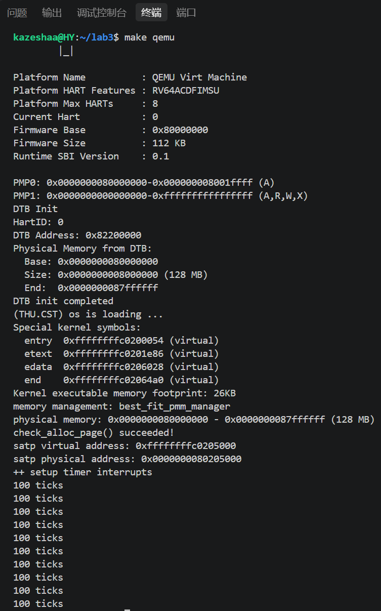
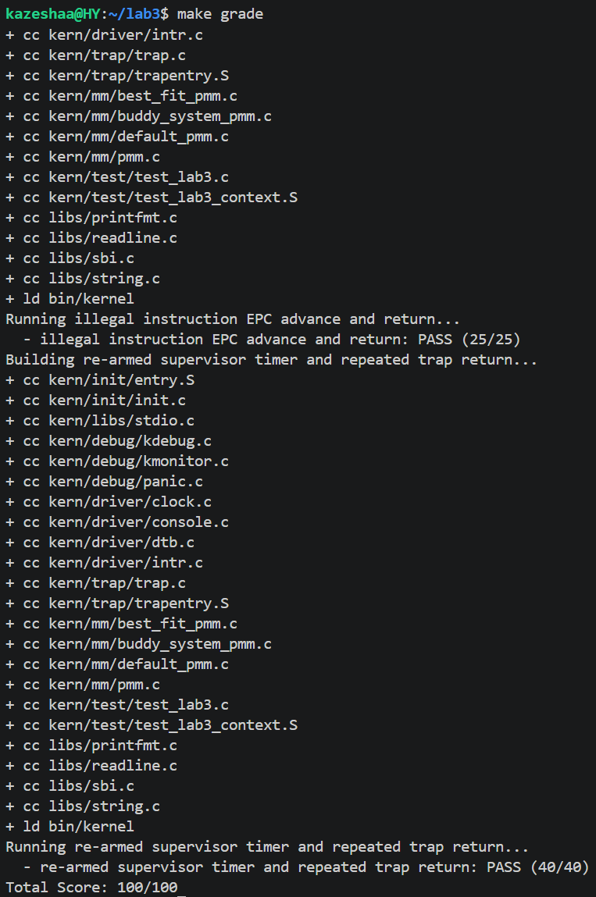

# 操作系统实验报告

## 实验基本信息

| 项目 | 内容 |
|------|------|
| **实验名称** | Lab 3: [断，都可以断] |
| **小组成员** | 2412350-华洋 |
| **完成日期** | 2026-11-04 |

### 小组分工

本实验为单人小组，由我一人完成全部练习与实验报告。

| 成员 | 负责的练习/模块 |
|------|----------------|
| 2412350-华洋 | 中断入口与上下文切换（trapentry.S）、中断/异常分发处理（trap.c）、时钟中断与中断开关、实验报告 |

---

## 一、实验目的

本实验的主要目的是：

1. 理解 RISC-V 的中断/异常机制：当中断发生时，CPU 如何自动保存现场、跳转到 `stvec` 指向的中断入口，并在处理后返回原执行流。
2. 掌握上下文切换：用汇编实现寄存器的保存与恢复（`SAVE_ALL`/`RESTORE_ALL`），理解 `trapframe` 结构如何组织 CPU 的完整上下文。
3. 掌握中断与异常的分发处理：实现 `interrupt_handler`（时钟中断的持续触发与统计）和 `exception_handler`（非法指令、断点异常的识别与 `epc` 正确推进）。
4. 学习使用 AI 辅助开发操作系统核心功能，并记录提示词设计、问题定位与迭代过程。

---

## 二、实验环境

| 成员 | AI 编程工具 | 底层模型 | 备注 |
|------|------------|---------|------|
| 2412350-华洋 | Claude Code（终端 Agent） | deepseek-v4-pro | WSL Ubuntu + riscv64-unknown-elf-gcc + QEMU |

**说明：**
- **AI 编程工具**：Claude Code（终端 Agent），用于生成中断入口汇编与中断/异常处理代码。
- **底层模型**：deepseek-v4-pro。

---

## 三、实验整体逻辑分析

### 2.1 本章节的逻辑主线

本章围绕「**中断/异常处理的完整链路**」展开：从硬件检测到中断、跳转到内核入口，到内核保存上下文、分派处理，最后恢复上下文返回。核心要解决的是「CPU 正在执行某段代码时被打断后，如何安全地放下手头的事、去处理中断、再回到原处继续执行」。

整条链路可以概括为：

```
硬件触发中断/异常
   → 跳转到 stvec 指向的 __alltraps（trapentry.S）
   → SAVE_ALL 保存上下文，构造 trapframe
   → 调用 trap(tf)（trap.c）
   → trap_dispatch 根据 tf->cause 区分中断/异常
   → interrupt_handler / exception_handler 处理
   → 返回 __trapret，RESTORE_ALL 恢复上下文
   → sret 回到被打断的指令处
```

### 2.2 功能的逐步实现

1. 首先实现**中断入口与上下文切换**（`kern/trap/trapentry.S` 的 `SAVE_ALL`/`RESTORE_ALL` 与 `__alltraps`）→ 为什么首先实现这个？因为它是所有中断/异常的第一站，任何后续处理都建立在其保存现场、传递 `trapframe` 的基础之上。
2. 接着完成**中断/异常分发**（`kern/trap/trap.c` 的 `idt_init` 与 `trap_dispatch`）→ 为什么接着实现这个？因为需要把 `stvec` 指向入口、并让 `trap` 能按 `cause` 把中断和异常分派到不同处理函数。
3. 然后实现**中断处理与异常处理**（`interrupt_handler`/`exception_handler`）→ 为什么然后实现这个？时钟中断要能持续触发并计数，非法指令/断点要能正确更新 `epc` 避免死循环，这是本实验要验证的核心功能。
4. 最后依赖框架已提供的**时钟初始化与中断开关**（`clock.c`/`intr.c`）把整条链串起来 → 为什么最后实现这个？时钟初始化（`clock_init`）负责第一次设置时钟事件、使能 `sie`，中断开关（`intr_enable`）负责打开全局中断，二者让上面的处理逻辑真正被硬件触发。

---

## 四、实验内容与实现

### 功能模块一：中断入口与上下文切换（trapentry.S）

**负责人：** 2412350-华洋

#### 模块功能描述

**需要实现/修改的函数：**

```c
// kern/trap/trapentry.S
.macro SAVE_ALL          // 保存所有通用寄存器与 4 个 CSR 到内核栈
.macro RESTORE_ALL       // 从内核栈恢复所有寄存器与 CSR
__alltraps:              // 中断入口：SAVE_ALL 后调用 trap(tf)
__trapret:               // 中断返回：RESTORE_ALL 后 sret
```

**功能说明：**

该模块是中断处理的第一站和最后一站，作用是在 CPU 进入/离开中断处理时保存/恢复完整上下文。当中断发生时，RISC-V 硬件会自动把返回地址写入 `sepc`、把原因写入 `scause`，然后跳到 `stvec` 指向的 `__alltraps`。

- `SAVE_ALL`：先在栈上开 36 个 `REGBYTES` 槽位，保存 31 个通用寄存器（`x0` 硬连线为 0 也保存以对齐），再把 `sstatus`/`sepc`/`sbadaddr`/`scause` 依次存入第 32~35 槽位，形成一个 `struct trapframe`。栈指针 `sp` 通过 `sscratch` 中转保存到第 2 槽位。
- `__alltraps`：`move a0, sp` 把 `trapframe` 指针作为参数，`jal trap` 调用 C 层处理函数。
- `RESTORE_ALL`：先恢复 4 个 CSR（其中 `sepc` 可能已被 `exception_handler` 修改，从而越过异常指令），再恢复通用寄存器，最后恢复 `sp`，随后 `sret` 返回。

**关键理解点：**
- `trapframe` 的 36 个槽位与 `struct trapframe` 一一对应（32 个 gpr + status/epc/badvaddr/cause），是汇编与 C 层之间传递上下文的契约。
- `sp` 必须**最后**恢复（`LOAD x2, 2*REGBYTES(sp)`），因为前面的恢复都要用 `sp` 去寻址栈。
- `csrw sscratch, sp` + `csrrw s0, sscratch, x0` 的双重作用：既保存了旧 `sp`，又把 `sscratch` 清零，便于区分「中断前处于内核态」。

#### 最终提示词

````markdown
参考 riscv64-ucore 的中断入口实现，补全 kern/trap/trapentry.S 里标有
"lab3 function1 YOUR CODE" 的两处：
1. 实现 RESTORE_ALL 宏：与已有的 SAVE_ALL 严格对称，从栈上按 32/33/34/35 槽位
   恢复 sstatus/sepc/sbadaddr/scause 并写回 CSR，再恢复 x1、x3~x31 共 31 个通用
   寄存器，最后用 LOAD x2, 2*REGBYTES(sp) 恢复 sp；
2. 在 __alltraps 的 SAVE_ALL 之后，用 move a0, sp 把 trapframe 指针作为参数，
   再 jal trap 调用 C 层 trap 函数，之后落入 __trapret。
注意：sepc 可能已被异常处理修改，必须从栈上读回；x0 硬连线为 0 无需恢复。
````

#### 实现迭代过程

本模块的实现经历了 **1 次迭代**。

**最终结果：**

- ✅ 编译通过
- ✅ 所有相关测试通过（`make grade` 中 `[Test 1]` 验证寄存器恢复与断点返回 PASS）
- ✅ 功能符合预期（`SAVE_ALL`/`RESTORE_ALL` 对称，`sp` 最后恢复，`trap` 参数正确传递）

---

### 功能模块二：中断/异常分发处理（trap.c）

**负责人：** 2412350-华洋

#### 模块功能描述

**需要实现/修改的函数：**

```c
// kern/trap/trap.c
void interrupt_handler(struct trapframe *tf);   // 中断处理
void exception_handler(struct trapframe *tf);   // 异常处理
static inline int trap_insn_length(uintptr_t epc);  // 判断异常指令长度
```

**功能说明：**

该模块负责在 `trap_dispatch` 按 `tf->cause` 区分中断/异常后，具体完成处理逻辑。

- `interrupt_handler`：先 `(tf->cause << 1) >> 1` 清掉最高位（中断标志位）得到真正原因号。时钟中断 `IRQ_S_TIMER` 依次完成：设置下一次时钟事件、`ticks++`、每 `TICK_NUM` 次输出统计信息、累计输出 `SHUTDOWN_AFTER` 次后调用 `sbi_shutdown()` 关机；其他中断做类型区分提示；未知中断打印 `Unknown interrupt: cause %d`。
- `exception_handler`：非法指令与断点异常输出规定格式信息，并按对应指令的实际长度正确推进 `tf->epc`；其余异常用 `print_trapframe` 兜底。
- `trap_insn_length`：读 `epc` 处指令的最低两位，`0b11` 为 4 字节指令、否则为 2 字节压缩指令，用于 `epc` 推进。

**关键理解点：**
- 非法指令（`.word 0x0000007b`）是 4 字节，`ebreak` 视工具链可能是 2 字节或 4 字节，所以**不能写死偏移量**，要结合 RISC-V 指令编码规则动态判断。
- `sepc` 在 `RESTORE_ALL` 里写回，因此 `exception_handler` 修改 `tf->epc` 后，`sret` 返回时会跳过异常指令，避免异常死循环。

#### 最终提示词

````markdown
参考 riscv64-ucore 框架，在 kern/trap/trap.c 里实现 interrupt_handler 和
exception_handler（标有 "lab3 function2 YOUR CODE" 处）：
1. interrupt_handler：用 (tf->cause << 1) >> 1 清最高位得到原因号，switch 区分
   各类中断；IRQ_S_TIMER 分支完成 clock_set_next_event()、ticks++、每 TICK_NUM
   次调用 print_ticks() 并计数、累计输出 SHUTDOWN_AFTER 次后 sbi_shutdown()；
   未知中断打印 "Unknown interrupt: cause %d"；
2. exception_handler：CAUSE_ILLEGAL_INSTRUCTION 和 CAUSE_BREAKPOINT 分别输出
   "Illegal instruction at 0x..." 和 "Breakpoint at 0x..."，并按指令实际长度
   推进 tf->epc（读 epc 处最低两位，0b11 为 4 字节、否则 2 字节）；其余异常
   print_trapframe(tf) 兜底。
另外在文件顶部补充 #include <sbi.h>（sbi_shutdown 声明所在头文件）。
不要修改 idt_init、trap_dispatch、trap、print_trapframe 等已有函数。
````

#### 实现迭代过程

本模块的实现经历了 **2 次迭代**。

---

##### 第一次迭代

**遇到的问题：**

- 问题1：编译报错 `implicit declaration of function 'sbi_shutdown'`。原因是 `interrupt_handler` 调用了关机接口，但 `trap.c` 顶部漏了 `#include <sbi.h>`，而工程开启了 `-Werror` 把隐式声明当成了错误。
- 问题2：最初对非法指令和断点都写死 `tf->epc += 4`（或都 `+= 2`）。由于非法指令是 4 字节的 `.word 0x0000007b`，而 `ebreak` 在压缩指令开启时可能是 2 字节，写死会导致其中某类异常返回后跳到指令中间，形成异常循环。

**问题解决策略：**

- 针对问题1：在提示词中明确要求「在文件顶部补充 `#include <sbi.h>`」。
- 针对问题2：改为实现 `trap_insn_length(epc)`，读 `epc` 处最低两位动态判断指令长度，非法指令与断点统一用 `tf->epc += trap_insn_length(tf->epc)` 推进，覆盖两种指令长度的情况。

---

##### 第二次迭代

**最终结果：**

- ✅ 编译通过
- ✅ `make grade` 三个用例全部 PASS，`Total Score: 100/100`
- ✅ 功能符合预期（时钟中断持续触发、非法指令/断点 `epc` 正确推进、兜底输出符合规定格式）

**关键改进点总结：**

1. 补充了 `#include <sbi.h>`，消除 `sbi_shutdown` 隐式声明错误。
2. 用「指令最低两位判断长度」取代写死偏移量，正确处理 4 字节非法指令与 2/4 字节断点指令。

---

## 五、测试与验证

**测试截图：**

- `make qemu` 输出：能持续打印 `100 ticks`（每 100 次时钟中断输出一次），说明时钟中断被正确重新武装并计数。



- `make grade` 输出：三个用例全部 PASS。



---

## 六、实验总结与收获

### 对操作系统的理解

**本实验中的重要知识点与对应 OS 原理：**

| 实验知识点 | 对应 OS 原理 | 含义、关系与差异 |
|---|---|---|
| 中断/异常机制，`stvec`/`scause`/`sepc`/`sscratch` 等 CSR | 中断系统、中断向量表 | 原理课讲通用中断流程（保存现场→跳转→处理→返回）；实验落到 RISC-V 的具体实现：`stvec` 存入口地址（Direct 模式单一入口）、`scause` 存原因、`sepc` 存返回地址 |
| 上下文切换（`SAVE_ALL`/`RESTORE_ALL` 保存恢复寄存器） | 进程上下文切换 | 原理课讲进程切换要保存/恢复 CPU 上下文；实验用汇编在栈上构造 `trapframe` 完成同样的保存/恢复，是后续进程切换的基础 |
| 特权级切换（`sret`、`sstatus` 的 SPP/SPIE） | 特权级、系统调用 | `sret` 根据 `sstatus.SPP` 回到被打断的特权级，并根据 SPIE/SIE 恢复中断使能；这是「进入内核→返回」的硬件机制 |
| 时钟中断的重新武装 | 定时器中断、时间片 | 硬件只触发一次时钟事件，实验用「每次中断设置下一次事件」实现周期性的时钟中断，这是时间片轮转调度的基础 |
| 原子操作（`intr_disable`/`intr_enable`、`sstatus.SIE`） | 临界区、互斥 | 修改内存管理数据结构等临界区操作前关中断、操作后恢复，保证原子性 |
| 指令长度解码（`epc` 推进） | 指令编码、异常恢复 | 异常返回需跳过触发异常的指令；RISC-V 用指令最低两位判断 2 字节/4 字节，体现了「异常恢复要精确到指令边界」 |

**补充：对答辩中最后一个问题的解答**

本实验的原子操作基础设施 `kern/sync/sync.h` 中，`local_intr_save` 宏被定义为：

```c
#define local_intr_save(x) \
    do {                   \
        x = __intr_save(); \
    } while (0)
```

这里的 `do { ... } while (0)` 不是真正的循环（循环体只执行一次），而是 C 语言的**宏包装技巧**：让这个多语句宏展开后成为一个完整语句，从而能在 `if/else` 里安全使用。

如果偷懒写成 `#define local_intr_save(x) x = __intr_save();`，那么 `if (cond) local_intr_save(flag); else ...;` 展开后，宏自带的分号会把 `if` 提前结束，导致 `else` 悬空、编译报错。包上 `do { } while (0)` 后，整个宏是一条复合语句，调用处写的分号只是独立的空语句，问题随之消除。

这与「原子操作」知识点相互呼应：临界区的开关（`local_intr_save`/`local_intr_restore`）既要保证语义正确（保存/恢复 `SIE`），也要通过这种宏写法保证在任意控制流下都语法安全。

**OS 原理中很重要、但在本实验中没有对应上的知识点：**

1. **中断优先级与嵌套中断**：本实验所有中断统一入口、统一处理，未实现中断优先级和中断嵌套（处理中断时通常已关中断）。
2. **多核中断（IPI 核间中断）**：只有单核 `hart 0` 在跑，未涉及处理器间中断。
3. **中断下半部（bottom half）/软中断机制**：本实验在中断处理函数里直接完成所有工作，没有区分「上半部/下半部」。
4. **外设中断**：本实验只处理时钟中断（和用于测试的软件中断/异常），没有键盘、磁盘、网卡等真实外设中断。
5. **完整的中断向量表**：采用 Direct 模式（`stvec` 直指单一 `__alltraps`），未实现 vectored 模式的多入口向量表。

### AI 协作开发的经验

1. **把 spec 中的约束直接写进提示词最有效**：例如「时钟中断不能只计数不设置下一次事件」「不同异常指令长度不同、需结合编码规则判断」这两条来自指导书的关键约束，直接决定了生成代码的正确性。
2. **编译错误要定位根因而非表面**：`sbi_shutdown` 隐式声明的根因是漏 `#include <sbi.h>`，而不是「加一个声明」；贴完整错误信息能让 AI 快速定位。
3. **写死偏移量是常见坑**：AI 初版倾向于对 `epc` 写死 `+2` 或 `+4`，需要提示它「结合 RISC-V 指令编码规则动态判断」，否则某类异常会陷入死循环。
4. **AI 给出候选实现后仍需人工验证**：`make qemu` 看 `100 ticks` 是否持续、`make grade` 三个用例是否全过，才是最终的验收标准，不能只看「编译通过」。
