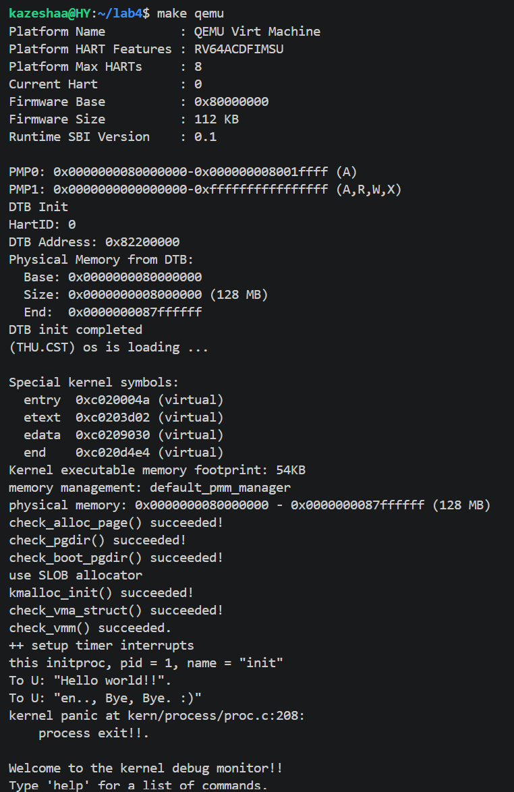
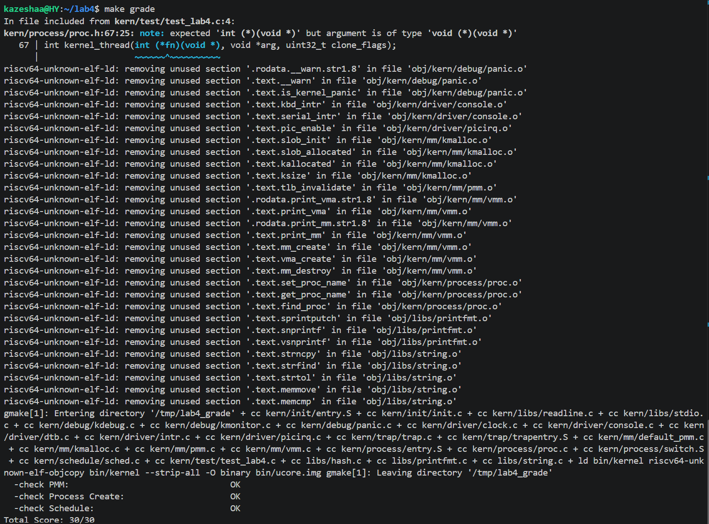

# 操作系统实验报告

## 实验基本信息

| 项目 | 内容 |
|------|------|
| **实验名称** | Lab 4: 进程管理 |
| **小组成员** | 2412350-华洋 |
| **完成日期** | 2026-11-19 |

### 小组分工

| 成员 | 负责的练习/模块 |
|------|----------------|
| 2412350-华洋 | 功能模块一：虚拟内存页操作；功能模块二：进程创建及初始化；功能模块三：进程调度；Challenge 思考题 |

---

## 一、实验目的

本实验的主要目的是：

1. 了解虚拟内存管理的基本结构，掌握虚拟内存的组织与管理方式：通过实现 `page_insert` / `page_remove`，理解页表项、物理页引用计数与 TLB 三者如何保持一致。
2. 了解内核线程创建/执行的管理过程：通过实现进程控制块 `proc_struct`、`alloc_proc`、`proc_init`、`kernel_thread`、`do_fork` 等，掌握内核线程从创建到首次运行的完整链路。
3. 了解内核线程的切换和基本调度过程：通过实现 `schedule`、`proc_run`、`switch_to`，理解上下文切换的本质（保存/恢复 callee-saved 寄存器）以及 FIFO 调度策略。

---

## 二、实验环境

| 成员 | AI 编程工具 | 底层模型 | 备注 |
|------|------------|---------|------|
| 2412350-华洋 | Claude Code（终端 Agent） | deepseek-v4-pro | WSL Ubuntu + riscv64-unknown-elf-gcc 14.2.0 + QEMU |

**说明：**
- **AI 编程工具**：Claude Code 终端 Agent，通过阅读实验指导书 PDF 与代码骨架，引导补齐各模块代码。
- **底层模型**：deepseek-v4-pro。

---

## 三、实验整体逻辑分析

### 3.1 本章节的逻辑主线

本章围绕「**让内核从单一执行流发展为能创建、调度多个内核线程的内核**」这一核心主题展开，同时补齐「**多级页表上的映射维护**」这一虚拟内存基础。整体可概括为三条主线：

- **虚拟内存页操作**（模块一）：在 lab2/lab3 已建好的多级页表框架上，实现物理页「挂载到线性地址」和「安全撤销映射」两个基本动作，为后续线程地址空间相关逻辑提供可靠基础。
- **进程创建与初始化**（模块二）：引入进程控制块 `proc_struct`，把当前执行现场包装成 `idleproc`，再通过 `kernel_thread` + `do_fork` 创建第一个真正的内核线程 `initproc`。
- **进程调度**（模块三）：实现调度器与上下文切换，让 `initproc` 从 `idleproc` 手中接管 CPU，真正跑起来。

三者是一条完整执行链：`kern_init -> pmm_init -> vmm_init -> proc_init -> cpu_idle -> schedule -> proc_run -> switch_to -> forkret -> forkrets -> __trapret -> kernel_thread_entry -> init_main`。前半段把地址空间准备好，后半段让第一个可运行线程真正运行。

### 3.2 功能的逐步实现

1. **首先实现虚拟内存页操作（模块一）**。因为进程/线程的内核栈分配、页表建立都依赖 `page_insert`/`page_remove` 这套映射维护接口；它也是 `check_pgdir`、`check_boot_pgdir` 自检能否通过的前提。
2. **接着实现进程创建与初始化（模块二）**。有了可用的页操作，才能分配内核栈、建立 `proc_struct`；`alloc_proc`/`proc_init`/`do_fork` 决定「线程从哪来、如何登记」。
3. **然后实现进程调度（模块三）**。有了线程对象，还需要 `schedule`/`proc_run`/`switch_to` 把它们真正交给 CPU，完成「从 idleproc 切换到 initproc」的最后一步。
4. **最后验证首次运行链路**。新线程第一次运行之所以能走到正确入口，是因为模块二已经把 `context.ra` 和 `trapframe` 组织成 `forkret -> forkrets -> __trapret` 这条恢复链路，模块三的 `switch_to` 只是把它启动起来。

---

## 四、实验内容与实现

### 功能模块一：虚拟内存页操作

**负责人：** 2412350-华洋

#### 模块功能描述

**需要实现/修改的函数：**

```c
// kern/mm/pmm.c
static inline void page_remove_pte(pde_t *pgdir, uintptr_t la, pte_t *ptep);
void page_remove(pde_t *pgdir, uintptr_t la);
int  page_insert(pde_t *pgdir, struct Page *page, uintptr_t la, uint32_t perm);
```

**功能说明：**

该模块在现有多级页表框架（Sv39，三级页表）上完成最基本的映射维护：把物理页挂到指定线性地址上（`page_insert`），以及把已有映射安全撤销（`page_remove`）。它们共同决定「一个线性地址最终对应哪一页物理内存」，同时决定「物理页引用计数是否正确、页表状态是否一致、TLB 是否需要失效」。

核心约束是保持**页表项内容、物理页引用计数、TLB 状态**三者同步：

- `page_insert` 不能简单覆盖旧项，要区分「原地址已映射到同一物理页」（此时只需撤销多余的引用计数）与「原地址已映射到其他物理页」（此时先 `page_remove_pte` 清掉旧映射再写入）。
- `page_remove` 是幂等删除接口：目标地址有映射时删除、无映射时安静返回，不把「未映射地址」当异常。
- 所有页表更新后都要 `tlb_invalidate`，否则 TLB 里残留的旧翻译会让测试出现「看似已更新、实际仍在使用旧结果」的现象。

#### 最终提示词

````markdown
参考 lab4 练习文档，在 kern/mm/pmm.c 中实现 page_insert、page_remove 以及辅助函数
page_remove_pte。要求：
1. page_insert(pgdir, page, la, perm)：get_pte(pgdir, la, 1) 获取页表项，失败返回 -E_NO_MEM；
   page_ref_inc(page)；若原地址已有有效映射（*ptep & PTE_V），区分两种情况：
   若映射的就是同一物理页（p == page）则 page_ref_dec(page) 撤销多余引用，
   否则先 page_remove_pte 清掉旧映射；写入 pte_create(page2ppn(page), PTE_V | perm)；
   tlb_invalidate；返回 0。
2. page_remove(pgdir, la)：get_pte(pgdir, la, 0)，非空则调用 page_remove_pte。
3. page_remove_pte：若 *ptep 有效，page_ref_dec(page) 归零就 free_page，清空 *ptep=0，tlb_invalidate。
4. 注意保持"页表项、引用计数、TLB"三者同步，page_remove 要幂等。
只给代码，不要修改其他文件。
````

#### 实现迭代过程

本模块的实现经历了 **1 次迭代**：

##### 第一次迭代

**最终结果：**

经过 1 次迭代，该模块最终：
- ✅ 编译通过
- ✅ `check_pgdir() succeeded!`、`check_boot_pgdir() succeeded!` 通过
- ✅ `[Test PMM] PASS`

**关键改进点总结：**
1. 在提示词里就明确了 `page_insert` 要区分「映射到同一物理页」与「映射到其他物理页」两种情况，避免直接 `page_ref_inc` 后覆盖旧项导致引用计数错误。
2. 明确 `page_remove` 的幂等语义（未映射地址安静返回），与 `check_pgdir` 里对同一地址反复 `page_remove` 的测试对应。

---

### 功能模块二：进程创建及初始化

**负责人：** 2412350-华洋

#### 模块功能描述

**需要实现/修改的函数：**

```c
// kern/process/proc.c
static struct proc_struct *alloc_proc(void);
void proc_init(void);
int  kernel_thread(int (*fn)(void *), void *arg, uint32_t clone_flags);
int  do_fork(uint32_t clone_flags, uintptr_t stack, struct trapframe *tf);
static void copy_thread(struct proc_struct *proc, uintptr_t esp, struct trapframe *tf);
static int  copy_mm(uint32_t clone_flags, struct proc_struct *proc);
```

**功能说明：**

该模块把系统从「已经能运行内核代码」推进到「已经能创建并登记多个内核线程」。

- `alloc_proc` 得到一个「干净空白」的进程控制块，所有字段安全初始化（`state=PROC_UNINIT`、`pid=-1`、`pgdir=boot_pgdir_pa` 等），避免后续代码误用未初始化字段。
- `proc_init` 把当前执行现场包装成 `idleproc`（`pid=0`、复用 `bootstack`、`need_resched=1`），再通过 `kernel_thread(init_main, "Hello world!!", 0)` 创建第一个真正的内核线程 `initproc`。
- `kernel_thread` 把函数入口 `fn` 和参数 `arg` 整理成线程首次运行所需的临时 `trapframe`，交给 `do_fork`。
- `do_fork` 完成七件事：`alloc_proc` → `setup_kstack` → `copy_mm` → `copy_thread` →（关中断）分配 pid、挂链表、`nr_process++` → `wakeup_proc` → 返回 pid，前三步失败要做对应清理。
- `copy_thread` 把 trapframe 放到新线程自己的内核栈顶，并设置 `context.ra=forkret`、`context.sp=tf`，与 `forkret/forkrets/__trapret` 形成首次运行链路。
- `copy_mm` 在本实验是占位：内核线程共享内核地址空间，`current->mm == NULL`，直接返回 0。

#### 最终提示词

````markdown
参考 lab4 练习文档，在 kern/process/proc.c 中实现 alloc_proc、proc_init、kernel_thread、
do_fork、copy_thread、copy_mm。要求：
1. alloc_proc：kmalloc 一个 proc_struct 并 memset 清零，state=PROC_UNINIT、pid=-1、
   pgdir=boot_pgdir_pa，其余指针/数值字段置空/0；失败返回 NULL。
2. proc_init：初始化 proc_list 与 hash_list；alloc_proc 得到 idleproc，设 pid=0、
   state=PROC_RUNNABLE、kstack=(uintptr_t)bootstack、need_resched=1、名字"idle"，nr_process++；
   current=idleproc；kernel_thread(init_main,"Hello world!!",0) 创建 initproc（pid=1），名字"init"。
3. kernel_thread：构造临时 trapframe（memset 清零），s0=fn、s1=arg、epc=kernel_thread_entry、
   status=(read_csr(sstatus)|SSTATUS_SPP|SSTATUS_SPIE)&~SSTATUS_SIE；
   返回 do_fork(clone_flags|CLONE_VM, 0, &tf)。
4. do_fork：alloc_proc→setup_kstack→copy_mm→copy_thread→（关中断）get_pid+hash_proc+
   list_add+nr_process++→wakeup_proc→返回 pid；前三步失败做对应清理（put_kstack/kfree）。
5. copy_thread：把 trapframe 放到 proc->kstack+KSTACKSIZE 栈顶，a0=0、
   sp=(esp==0)?(uintptr_t)tf:esp，context.ra=forkret、context.sp=tf。
6. copy_mm：内核线程 mm 为 NULL，直接 return 0。
注意：copy_thread 和 copy_mm 是 static 函数，必须定义在 do_fork 之前。
只给代码，不要修改其他文件。
````

#### 实现迭代过程

本模块的实现经历了 **2 次迭代**：

##### 第一次迭代

**遇到的问题：**
- 问题1：编译报错 `static declaration of 'copy_thread' follows non-static declaration` 与 `static declaration of 'copy_mm' follows non-static declaration`。
- 原因分析：`do_fork` 调用了 `copy_thread`、`copy_mm`，但这两个是 `static` 函数且最初定义在 `do_fork` 之后，C 编译器对它们的调用按隐式声明（external）处理，与后面的 `static` 定义冲突。

**问题解决策略：**
- 针对问题1：调整提示词，明确要求「`copy_thread` 和 `copy_mm` 是 static 函数，必须定义在 `do_fork` 之前」；同时把这两个函数的定义上移到 `do_fork` 之前。

##### 第二次迭代

**最终结果：**

经过 2 次迭代，该模块最终：
- ✅ 编译通过
- ✅ `[Test Process Create] PASS`（验证 idleproc/initproc 的 pid、状态、父进程、context 等字段）
- ✅ 功能符合预期

---

### 功能模块三：进程调度

**负责人：** 2412350-华洋

#### 模块功能描述

**需要实现/修改的函数：**

```c
// kern/process/proc.c
void cpu_idle(void);
void proc_run(struct proc_struct *proc);
// kern/schedule/sched.c
void schedule(void);
// kern/process/switch.S
void switch_to(struct context *from, struct context *to);
```

**功能说明：**

该模块把已经创建出来的内核线程真正交给 CPU 执行。

- `cpu_idle` 作为空闲线程的执行主体，死循环检查 `current->need_resched`，需要重调度时调用 `schedule()`。
- `schedule` 在关中断的临界区内从 `proc_list` 选出下一个 `PROC_RUNNABLE` 线程：当前是 idleproc 时从链表头开始，否则从当前线程下一个开始（Round-Robin），找不到可运行线程则回退到 idleproc；然后 `proc_run(next)`。
- `proc_run` 在关中断临界区内更新 `current`、切换页表（写 satp）并调用 `switch_to` 完成寄存器上下文切换。
- `switch_to` 只做最底层的 callee-saved 寄存器保存/恢复，不参与调度策略判断。

#### 最终提示词

````markdown
参考 lab4 练习文档，实现 cpu_idle、proc_run（kern/process/proc.c）、schedule
（kern/schedule/sched.c）、switch_to（kern/process/switch.S）。要求：
1. cpu_idle：死循环，current->need_resched 非 0 就 schedule()。
2. schedule：关中断下 current->need_resched=0；从 proc_list 找下一个 PROC_RUNNABLE
   （当前是 idleproc 从表头开始，否则从 current->list_link 之后开始），找不到回退 idleproc；
   next->runs++；next != current 则 proc_run(next)；最后恢复中断。
3. proc_run：关中断下 current=proc，写 satp（参照 pmm.c 的 enable_paging，使用
   write_csr(satp, 0x8000000000000000 | (proc->pgdir >> RISCV_PGSHIFT))，不要用 lsatp()），
   然后 switch_to(&prev->context, &next->context)；最后恢复中断。
4. switch_to：汇编实现，保存/恢复 ra、sp、s0~s11 共 14 个寄存器，STORE/LOAD 的偏移
   顺序必须与 struct context 字段顺序一致（0=ra、1=sp、2=s0 ... 13=s11），最后 ret。
只给代码，不要修改其他文件。
````

#### 实现迭代过程

本模块的实现经历了 **1 次迭代**：

##### 第一次迭代

**最终结果：**

经过 1 次迭代，该模块最终：
- ✅ 编译通过
- ✅ `[Test Schedule] PASS`（验证两个测试线程能通过 `schedule`/`switch_to` 交替运行）
- ✅ 功能符合预期

**关键改进点总结：**
1. 在提示词里明确了 `switch_to` 的寄存器保存顺序必须与 `struct context` 字段顺序（ra, sp, s0~s11）严格一致。
2. 明确了 `proc_run` 写 satp 不能用 `libs/riscv.h` 里的 `lsatp()`（那是 Sv32 遗留，无法表达 Sv39 的 satp），而要参照 `pmm.c` 的 `enable_paging()` 写法。

---

### Challenge

**负责人：** 2412350-华洋

#### Challenge 1：`local_intr_save(intr_flag); ... local_intr_restore(intr_flag);` 如何实现开关中断

从 `kern/sync/sync.h` 看，`local_intr_save(x)` 展开为 `__intr_save()`：它读取 `sstatus` 寄存器的 `SIE` 位；若 `SIE==1`（中断已使能），则调用 `intr_disable()` 清除 `SIE` 关闭中断，并返回 1；若本来 `SIE==0`，则返回 0。`local_intr_restore(x)` 展开为 `__intr_restore(x)`：只有当传入的标志 `x==1`（说明保存前中断是开的）时才调用 `intr_enable()` 重新开启中断。

这实现的是「保存—恢复」中断使能状态，而不是「无条件开/关」：进入临界区前关闭中断，退出临界区时恢复到进入前的状态。这样既保证 `schedule`/`proc_run` 这些临界区不被中断打断，又避免「本来就没开中断的上下文，退出时被误开」。

#### Challenge 2：`get_pte()` 中两段相似代码，结合 sv32/sv39/sv48 解释为何相像；是否应把「查找」和「分配」拆开

`get_pte()` 中两段相似的代码分别处理 Sv39 三级页表的 PDX1 级和 PDX0 级目录项：都是「检查当前级页表项是否有效（`PTE_V`），无效则根据 `create` 标志分配一个物理页做下一级页表、清零并写入页表项，然后通过 `PDE_ADDR` 拿到下一级页表基址继续下降」。之所以相像，是因为 Sv32/Sv39/Sv48/Sv57 本质上是同一套「多级树状页表」，只是级数不同（2/3/4/5 级）；每一级的「查项 → 可选建表 → 下降」是同一个模式，仅索引位宽与级数不同，因此代码形式重复。

关于是否拆分「查找」和「分配」：本实验把二者合并到一个函数里，用 `create` 参数区分，对 ucore 这种小型内核是合理的——接口简单，调用方无需关心中间级页表是否已存在。缺点是「只读查找」（`create=0`）也必须走一遍带分配分支的代码路径。若要更清晰，可以拆成 `find_pte`（只查）与 `alloc_pte`（只建），但会多一层调用、收益有限，本实验保留合并写法。

---

## 五、测试与验证

**测试截图：**

编译与运行（`make qemu`）关键输出：

```
physical memory: 0x0000000080000000 - 0x0000000087ffffff (128 MB)
check_alloc_page() succeeded!
check_pgdir() succeeded!
check_boot_pgdir() succeeded!
use SLOB allocator
kmalloc_init() succeeded!
check_vma_struct() succeeded!
check_vmm() succeeded.
++ setup timer interrupts
this initproc, pid = 1, name = "init"
To U: "Hello world!!".
To U: "en.., Bye, Bye. :)"
kernel panic at kern/process/proc.c:208:
    process exit!!.
```

打分（`make grade`）结果：

```
-check PMM:              OK
-check Process Create:   OK
-check Schedule:         OK
Total Score: 30/30
```





---

## 六、实验总结与收获

### 对操作系统的理解

**本实验中的重要知识点与对应 OS 原理：**

| 实验知识点 | 对应 OS 原理 | 含义、关系与差异 |
|---|---|---|
| 多级页表（Sv39 三级）的 `get_pte`/`page_insert`/`page_remove` | 分页存储管理 / 页表 | 原理课讲通用多级页表和地址翻译；实验落到 RISC-V Sv39 的 PDX1/PDX0/PTX 三级索引与 PTE 的 PPN/权限位，并强调页表项、引用计数、TLB 三者同步 |
| 物理页引用计数（`ref`） | 内存共享与回收 | `page_insert` 增引用、`page_remove` 减引用、归零释放，是「同一物理页可被多个线性地址映射」的正确回收基础 |
| 进程控制块 `proc_struct` 与进程树（parent） | 进程控制块 PCB / 进程状态 | 原理课讲 PCB 与进程生命周期状态；实验用 `state`（UNINIT/SLEEPING/RUNNABLE/ZOMBIE）、`parent` 父子关系组织，`proc_list` + `hash_list` 双链表登记 |
| 上下文切换（`context` 保存 ra/sp/s0~s11） | 进程上下文切换 / 调度 | 原理课讲上下文保存恢复；实验只保存 callee-saved 寄存器，利用编译器对 caller-saved 的自动保存，减少切换开销 |
| 中断帧 `trapframe` 与首次运行链路（forkret→forkrets→__trapret→kernel_thread_entry） | 进程创建 / 特权级切换 | 通过伪造 trapframe 并借助 sret 恢复，让新线程「像是从中断返回」一样进入入口函数，是 fork 语义在无父进程情况下的巧妙构造 |
| FIFO/Round-Robin 调度 | 进程调度策略 | `schedule` 在 `proc_list` 中轮转查找 RUNNABLE 线程，idleproc 兜底；对应原理课的轮转调度 |
| 开关中断保护临界区（local_intr_save/restore） | 临界区 / 互斥 | 调度和进程切换必须原子，通过关中断保证 `current`、页表、执行现场一致，对应原理课的临界区保护 |

**OS 原理中很重要、但在本实验中没有对应上的知识点：**

1. **请求调页（demand paging）与缺页异常处理**：本实验仍是预映射方式，一次性建立映射，缺页处理和按需分配在后续实验。
2. **页置换算法（FIFO/LRU/Clock/OPT）与 swap**：没有页面换出到磁盘，也就没有置换策略。
3. **用户态进程与地址空间隔离**：本实验只有内核线程，PTE 的 U 位、内核/用户隔离未真正体现。
4. **写时复制（COW）、共享内存、mmap**：`copy_mm` 在本实验只是占位，用户地址空间复制与 COW 在后续实验。
5. **更复杂的调度算法（优先级、多级反馈队列、时间片抢占）**：本实验只有 FIFO/轮转，且调度点唯一在 `cpu_idle`。
6. **进程同步互斥原语（信号量、锁、管程）**：`sync.h` 里只有开关中断的简单原语，未涉及 sleep/wakeup 之外的完整同步机制。
7. **TLB 的 ASID 与多地址空间管理**：只看到 `satp` 中的 Sv39 模式与根页表页号，未涉及 ASID 复用。

### AI 协作开发的经验

1. **把 PDF 的接口说明与约束条件直接转成结构化提示词**：例如把「page_insert 要区分同一页/不同页」「page_remove 要幂等」「写 satp 不能用 lsatp()」这些边界写进提示词，代码就能一次通过，避免多轮返工。
2. **函数定义顺序这类编译错误要看根因而非表面**：`static declaration follows non-static declaration` 的根因是 `static` 函数定义在调用之后被当成隐式声明，解决方法是调整定义顺序（或加前置声明），而不是「加一个声明」。
3. **寄存器布局必须与结构体字段严格一致**：`switch_to` 的汇编 STORE/LOAD 偏移要对着 `struct context` 的字段顺序逐个核对，这类错误编译期不报，运行时才会表现为上下文错乱，需要靠对 ABI/结构的理解来预防。
4. **注意区分「代码 bug」和「环境/工具链问题」**：如 GCC14 + 新 binutils 的 `zmmul` 链接错误、`kmalloc.c` 的 `kva2page` 类型警告都是环境/骨架遗留，不是本次实现的逻辑问题，要能识别并跳过。
5. **AI 适合给出候选实现再由人验证**：多级页表引用计数、trapframe 构造、satp 写法等，AI 能快速给出实现，但仍需通过 `make qemu` / `make grade` 和对照指导书语义逐项核验正确性。
